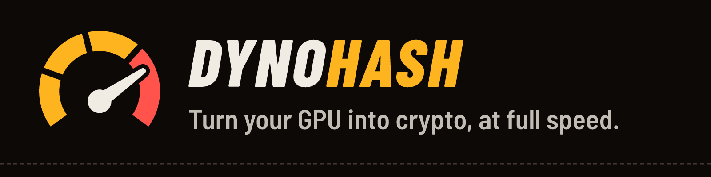
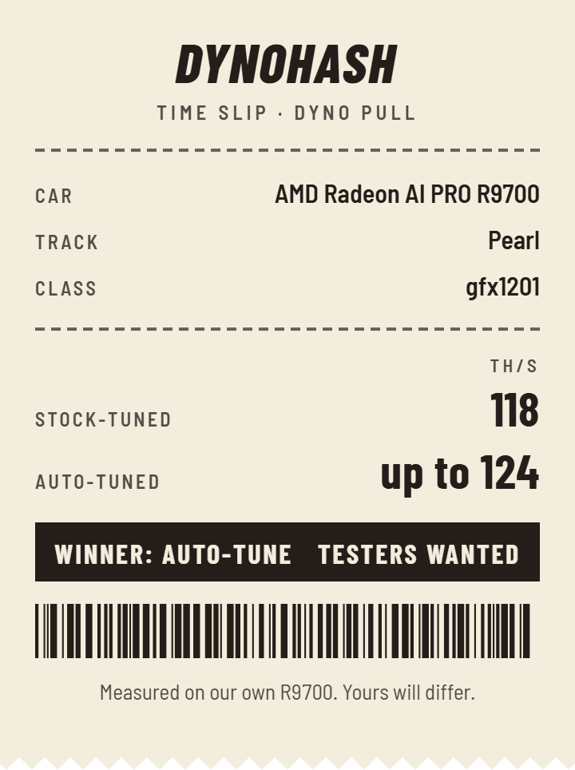

**Earn real crypto with your GPU.** Plug and play. Built to be the fastest.

DynoHash mines Pearl (PRL) on your graphics card, then tunes the card for more speed.

**[Download](#download)** · [Quick start](#quick-start) · [Verify your download](#verify-your-download) · [dynohash.com](https://dynohash.com)

## Why DynoHash

- **Dyno pull.** One button tunes your card. It keeps only settings that stay stable.
- **Time slips.** Every dyno pull ends with a slip: your speed before and after.
- **The Strip.** Real speeds from real rigs, card by card. [See The Strip](https://dynohash.com/the-strip/)
- **Plug and play.** Install it. Choose where to get paid. Press **Start mining**.

On our own R9700 it went from 106 TH/s at our first build to 142 TH/s tuned today. On an RTX 2080, from about 41 to about 69 TH/s.

<p align="center"></p>

## Download

Free · 2% dev fee · [Details](#dev-fee)<br>
Speed stats and card checks on (card, speed, power - nothing private). [Details](#speed-stats-and-card-checks)

| For | Download |
|:---|:---|
| **Windows** installer | [DynoHash-windows-x64-setup.exe](https://github.com/dynohash/dynohash/releases/latest/download/DynoHash-windows-x64-setup.exe) |
| **Windows** command line | [dynohash-windows-x64.zip](https://github.com/dynohash/dynohash/releases/latest/download/dynohash-windows-x64.zip) |
| **Linux** .deb (Ubuntu) | [DynoHash-linux-amd64.deb](https://github.com/dynohash/dynohash/releases/latest/download/DynoHash-linux-amd64.deb) |
| **Linux** AppImage | [DynoHash-linux-x64.AppImage](https://github.com/dynohash/dynohash/releases/latest/download/DynoHash-linux-x64.AppImage) |
| **Linux** command line | [dynohash-linux-x64.tar.gz](https://github.com/dynohash/dynohash/releases/latest/download/dynohash-linux-x64.tar.gz) |
| **HiveOS** | [dynohash-hiveos.tar.gz](https://github.com/dynohash/dynohash/releases/latest/download/dynohash-hiveos.tar.gz) |
| **mmpOS** | [dynohash-mmpos.tgz](https://github.com/dynohash/dynohash/releases/latest/download/dynohash-mmpos.tgz) |
| Checksums | [SHA256SUMS](https://github.com/dynohash/dynohash/releases/latest/download/SHA256SUMS) |

Every file has a signature: the same link with `.minisig` on the end. All files are on the [latest release](https://github.com/dynohash/dynohash/releases/latest) page.

> [!IMPORTANT]
> Only download DynoHash from **dynohash.com** or **github.com/dynohash**. Anything else is not us.
> [How to spot a fake](https://dynohash.com/spot-a-fake/)

## Quick start

### Windows 11

1. Download `DynoHash-windows-x64-setup.exe`.
2. [Verify it](#verify-your-download).
3. Run it. It needs no admin rights.<br>
   Windows may warn you, because the file is not code-signed. If step 2 passed, click **More info**, then **Run anyway**.
4. Open DynoHash. Choose where to get paid. Press **Start mining**.<br>
   If Windows Defender removes it, see [If Windows Defender flags DynoHash](DEFENDER.md).
5. Open **Dyno** and press **Start the dyno pull**. It takes a few minutes.

**Command line instead?**

1. Unzip `dynohash-windows-x64.zip`.
2. Put your pool and wallet in `start-example.bat`.
3. Run it.

### Linux

AMD cards need the AMD ROCm HIP runtime. NVIDIA cards need the NVIDIA driver.

**.deb (Ubuntu)**

```sh
sudo apt install ./DynoHash-linux-amd64.deb
```

Then open DynoHash from your apps.

**AppImage**

```sh
chmod +x DynoHash-linux-x64.AppImage
./DynoHash-linux-x64.AppImage
```

Will not start? Install FUSE first (Ubuntu 24.04):

```sh
sudo apt install libfuse2t64
```

**Command line**

```sh
tar xzf dynohash-linux-x64.tar.gz
cd dynohash-*-linux-x64
./dynohash devices
./dynohash mine \
  --wallet YOUR_WALLET \
  --worker rig1 \
  --pool stratum+ssl://prl-us.kryptex.network:8048
```

### HiveOS

Make a flight sheet. Pick **Custom** as the miner, then **Setup Miner Config**:

- **Miner name:** `dynohash`
- **Installation URL:** `https://github.com/dynohash/dynohash/releases/latest/download/dynohash-hiveos.tar.gz`
- **Wallet and worker template:** `%WAL%.%WORKER_NAME%`
- **Pool URL:** `stratum+ssl://prl-us.kryptex.network:8048`
- **Pass:** only if your pool wants one.

Tested pools: Kryptex, HeroMiners, K1Pool, 2Miners, AlphaPool, PearlFortune, LuckyPool, JetskiPool, Minerlab, Rabid Pool, Linkrra, Skypool, Suprnova and Rellik Pool. Addresses and copy-ready settings: [dynohash.com/download/#pools](https://dynohash.com/download/#pools).
- **Extra config arguments:** optional, see [below](#extra-arguments-for-rigs).

Your wallet goes into a private file on the rig, never onto the command line.

### mmpOS

Add a custom miner to a miner profile:

- **Download URL:** `https://github.com/dynohash/dynohash/releases/latest/download/dynohash-mmpos.tgz`
- **Coin:** Pearl
- **Pool:** `prl-us.kryptex.network:8048`, with TLS on
- **User:** `YOUR_WALLET.worker`
- **Extra arguments:** optional, see [below](#extra-arguments-for-rigs).

### Extra arguments for rigs

- `--autotune` lets DynoHash tune the cards. Rig packages do not tune without it.
- `--stats off` turns speed stats off.
- `--lan-dashboard` shows a read-only status page on your network, on port 13201.

## Verify your download

Do this before you run anything. It takes a minute.

**1. Check the checksum.** Download `SHA256SUMS` next to your file.

Windows (PowerShell):

```powershell
cd ~\Downloads
(Get-FileHash DynoHash-windows-x64-setup.exe).Hash
```

Find the same file name in `SHA256SUMS`. The two codes must match. Capital letters do not matter.

Linux:

```sh
cd ~/Downloads
sha256sum -c --ignore-missing SHA256SUMS
```

It must say "OK" after your file name.

**2. Check the signature.** Get [minisign](https://jedisct1.github.io/minisign/). Download the file's `.minisig` next to it. Then:

```sh
minisign -Vm <file> -P RWQKNwsiNKl9GGnY4LOinPmoCcLchlmduHDgROA2MmWJTXRUuPaZmPjv
```

It must say "Signature and comment signature verified".

> [!NOTE]
> minisign public key: `RWQKNwsiNKl9GGnY4LOinPmoCcLchlmduHDgROA2MmWJTXRUuPaZmPjv`<br>
> The same key is on [dynohash.com](https://dynohash.com/download/).

A check failed? Delete the file. Tell us: security@dynohash.com

## Supported cards

- **AMD Radeon AI PRO R9700** (gfx1201)
- **AMD Radeon RX 9000 series** (RDNA 4)
- **AMD Radeon RX 7000 series** (RDNA 3), including built-in Radeon 780M graphics
- **NVIDIA GeForce RTX 20 series** (tested on an RTX 2080)
- **NVIDIA GTX 10 series.** Works, but too slow to pay on Pearl.

More cards are being tested. Got another card? Try the [beta](https://dynohash.com/download/) and post your time slip.

Speed on our own R9700: 135 TH/s stock, up to 142 TH/s tuned at 300 W (DynoHash 0.1.2). Release 0.1.1 on Windows 11: 130 TH/s stock.
On our RTX 2080: about 69 TH/s at about 240 W.

Got a card that does not start, or a HiveOS or mmpOS rig? DynoHash checks every card the first time it runs
(see [card checks](#speed-stats-and-card-checks)). You can also [tell us how it runs](https://github.com/dynohash/dynohash/issues/new?template=card_test.yml).

## Details

### Dev fee

DynoHash is free. It keeps 2% of the mining time.

- **How much:** 120 seconds in every 100 minutes of mining.
- **Who gets it:** those minutes are mined for the DynoHash account, on a separate connection named `dynohash-fee`.
- **Where it shows:** the `dynohash-fee` worker shows on the DynoHash account, not on your pool dashboard.
  Your own worker shows a short dip during those minutes.
- **In the log:** each fee window is marked when it opens and when it closes.
- **Only mining time counts.** The count is saved, so a restart does not reset it or repeat a window.
- **Fee server down?** Your mining goes on. The missed fee time (10 minutes at most) moves to the next window.
- **No off switch.** No setting removes it. A build that says "0% fee" is a fake.
- **Nothing else.** The fee is the only thing we take.

The fee connection goes to the Kryptex pool (`prl-us.kryptex.network:8048`, TLS), whatever pool you use.
It is a normal connection that any network tool can see. Your pool password is never sent there.

Short version on our site: [Fee and privacy](https://dynohash.com/fee-and-privacy/)

### Speed stats and card checks

On by default. They help us make DynoHash faster for your card.

- **Sent:** card model, speed, power, temperature, fan, tune settings, and the DynoHash, driver and OS versions.
- **Never sent:** your wallet, pool login, worker name, computer name, user name, serial numbers or location.
- **Your IP address** is not stored or logged by our stats server.
- **How often:** at most once every 6 hours per rig, plus once after each dyno pull.
- **Kept:** 30 days after your rig last reports. Then deleted.
- **Shown in public:** only medians per card model on [The Strip](https://dynohash.com/the-strip/), once 5 rigs report that card.
  No single rig is shown.
- **Time slips are separate.** You choose to post each one.
  Your nickname is shown publicly with your time slip. Leave it blank to post as Anonymous.
- **Turn off:** in the app, Settings, then Speed stats and card checks. On the command line or a rig, add `--stats off`.
  The app's **View what's sent** button shows the last report.

**Card checks.** The first time DynoHash uses a card (per DynoHash version and driver), and whenever it cannot start a card,
it runs its own correctness check (the card's result against a CPU result) and a 60 second speed run. It then sends:

- DynoHash and OS version (numbers only), OS family (`windows`, `linux`, `hiveos`, `mmpos`).
- Card maker, model name, architecture, video memory and driver version.
- The result (`pass`, `fail` or `unsupported`), a short error code (for example `no_kernel`, `mismatch`, `oom`), and the speed and watts from the run.
- The same random install ID as speed stats.

Never sent: wallet, pool, worker name, IP address, computer name or paths. At most 20 checks per install per day.
Kept 90 days. It never slows mining. The app's **View what's sent** button shows the last check.
Off with the same switch: `--stats off`.

**Coin rate.** Whether speed stats are on or off, the app reads the current coin rate from api.dynohash.com about once an hour
and before each dyno pull, to show what your rig earns a day. That request sends nothing about you (no install ID, wallet, card
or settings); like any web request it shows our server your IP address, and it names the DynoHash version.

**Problem reports.** "Report a problem" builds a report on your PC, cleans out wallets, logins, names and addresses, and shows it
to you first. Only you send it. The exact format is
[the published schema](https://dynohash.com/stats-schema/cardcheck-v1.json).

<details>
<summary>Every field we send</summary>

- Report format version, DynoHash version, OS family and version.
- Driver or runtime version.
- For each card: maker, model name, architecture (for example `gfx1201`) and video memory in GB.
- The coin, and for each card: speed (10-minute average), watts, TH/W, hot spot and memory temperature, fan speed.
- Tune settings (power %, voltage offset, clocks, work size) and whether the dyno pull chose them.
- The share of rejected or stale shares, and error codes (codes only: no text, no file paths).
- A random install ID, made at install, to count each rig once. It is stored only as a one-way hash.
  It changes when you reinstall.

Sent over HTTPS to `api.dynohash.com` only. The server accepts only the fields in
[the published schema](https://dynohash.com/stats-schema/v1.json). If a report fails, mining carries on.

</details>

### Tuning (the dyno pull)

- The dyno pull is for AMD cards. NVIDIA cards are not tuned.
- It tests the card's power limit, voltage and work size.
- It keeps only settings where every share passes a check on your CPU.
- It saves the result for that card and that driver. A new driver needs a new dyno pull.
- It searches the core voltage until a step fails or gains under 0.5%, then backs off two notches.
- While you mine, it backs off at the first error. After 24 clean hours it tries one small step deeper, never past what the dyno pull proved.
- When DynoHash stops, your card goes back to stock.
- **Levels:** Street (quiet, fan up to 65%), Track (the default: the most profit, no fan limit; your temperature limit still protects the card), Nitrous (the most stable power after tuning, no fan cap).
- On Linux, card tuning needs root rights. Without them DynoHash mines at stock settings.

Stop DynoHash with **Stop mining**, Ctrl+C or `dynohash stop`. If it was force-closed, the next start puts the card back first.

### Your payout

- DynoHash pays the pool and wallet you choose. It never holds your coins.
- The first run remembers your pool and wallet. If they change later, DynoHash stops and asks.
  In the app, you confirm the new address on screen. On the command line, run once with `--confirm-payout`.

### Updates

- **The app** finds new versions and installs signed updates.
- **The command line** checks once a day and says so in the log. It never replaces itself.
  The check sends nothing about you. Add `--no-update-check` to turn it off.
- **Rigs** do not update themselves. Point the flight sheet (HiveOS) or profile (mmpOS) at the new package and apply it.

### Command line

- `dynohash devices` lists your cards and their numbers.
- `dynohash mine --help` shows every mining option.
- `dynohash tune --quick` runs the dyno pull, in about 5 minutes.
- `dynohash stop` stops a running miner. The cards go back to stock.
- `dynohash restore` puts any tuned card back to stock.
- `dynohash about` shows the version, the fee and what DynoHash connects to.

## Security

- Official downloads only: **dynohash.com** and **github.com/dynohash**.
- Every file has a SHA-256 checksum in `SHA256SUMS` and a minisign signature.
- We never ask for your seed phrase, private keys, passwords, remote access or money.
- Found a problem? Email security@dynohash.com. See [SECURITY.md](SECURITY.md).
- [How to spot a fake](https://dynohash.com/spot-a-fake/) · [Security](https://dynohash.com/security/)

## Help

- Windows Defender flagged DynoHash? [What to do](DEFENDER.md).
- Something broke? [Report a bug](https://github.com/dynohash/dynohash/issues/new?template=bug_report.yml).
- Tested a card? [Share your numbers](https://github.com/dynohash/dynohash/issues/new?template=card_test.yml).
- Anything else: support@dynohash.com

[dynohash.com](https://dynohash.com) · [The Strip](https://dynohash.com/the-strip/) · [Spot a fake](https://dynohash.com/spot-a-fake/) · [Fee and privacy](https://dynohash.com/fee-and-privacy/) · [Changelog](CHANGELOG.md)

<sub>This repo holds releases, docs and issues. The miner's source code is not public.</sub>
